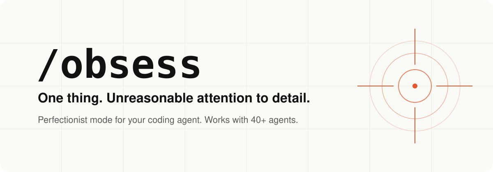

<p align="center">
  <picture>
    <source media="(prefers-color-scheme: dark)" srcset="docs/assets/banner-dark.svg">
    
  </picture>
</p>

<h1 align="center">/obsess: perfectionist mode for your AI coding agent</h1>

<p align="center">
  <strong>Point your agent at one thing that isn't quite right.<br>It checks its own work, keeps the best version and stops on purpose.</strong>
</p>

<p align="center">
  <a href="https://github.com/UmarSiddiqui/obsess/stargazers"></a>
  <a href="INSTALL.md"></a>
  <a href="https://agentskills.io/specification"></a>
  <a href="https://skills.sh/UmarSiddiqui/obsess"></a>
  <a href="LICENSE"></a>
  <a href="CHANGELOG.md"></a>
</p>

<p align="center">
  Claude Code · Codex · Cursor · Gemini CLI · GitHub Copilot · OpenCode · Windsurf · Cline · Amp · Goose · Kiro · Roo · <a href="INSTALL.md">+ more</a>
</p>

<p align="center">
  <a href="#install">Install</a> · <a href="#before--after">Before / after</a> · <a href="#tested-with-real-agent-runs">Test results</a> · <a href="#how-it-works">How it works</a> · <a href="#commands">Commands</a> · <a href="#faq">FAQ</a>
</p>

---

```text
/obsess over this toggle and make the transition super smooth
```

You know the moment. You ask for one small thing. The agent edits three files, says **"Done! The transition is now smooth ✨"** and never once looked at it.

`/obsess` is the opposite. One target. It looks at the thing before touching it, makes one justified change at a time, checks each attempt against the best so far, throws away regressions and stops when there's nothing real left to improve. Then it tells you exactly what it checked and what it couldn't.

**Not a redesign. Not an endless loop. Just unreasonable attention to the thing you picked.**

## Install

**Any agent** (Claude Code, Codex, Cursor, Gemini CLI, Copilot, OpenCode, Windsurf, Cline and 40+ more):

```bash
npx skills add UmarSiddiqui/obsess
```

**Claude Code plugin:**

```text
/plugin marketplace add UmarSiddiqui/obsess
/plugin install obsess@obsess
```

**Or just ask your agent:**

```text
Install the obsess skill from https://github.com/UmarSiddiqui/obsess. Follow its INSTALL.md for this agent.
```

Start a new session and type `/obsess`. Per-agent steps, `/obsess` slash commands for Cursor, Copilot, Windsurf, Cline and Gemini, an `AGENTS.md` rule for everything else and an offline installer: **[INSTALL.md](INSTALL.md)**.

## Before / after

Same agent, same request: *"make this toggle's transition super smooth"*. Illustrative, to show the behaviour change.

<table>
<tr>
<th width="50%">Without /obsess</th>
<th width="50%">With /obsess</th>
</tr>
<tr>
<td valign="top">

> I've updated the toggle with a smooth 300ms `ease-in-out` transition on `left` and `background-color`, and added a subtle bounce. I also refactored the shared `Switch` styles and tidied the theme tokens while I was there. The transition is now buttery smooth! ✨

Unchecked. Animates a layout property. Touched a shared component. Claims smoothness nobody saw.

</td>
<td valign="top">

> **Target:** `SettingsToggle` thumb motion. **Check:** record on/off and a mid-animation reversal; assert state; keyboard + reduced motion.
>
> **Attempt 1:** `left` → `transform`. Reversal no longer snaps in the recording. Kept.
> **Attempt 2:** springier easing. Overshoot on reversal. **Rejected**, attempt 1 stays best.
>
> **Checked:** Chromium, recording + state assertions, Space key, reduced motion.
> **Not verified:** Safari. **Stopped:** goal met, next idea didn't help.

</td>
</tr>
</table>

## How it works

```text
pin one target → say how it'll be checked → protect the original
      ↓
one justified attempt → inspect it → keep it only if it beats the best so far
      ↓
stop on purpose → honest report: changed / checked / not verified
```

1. **One target, smallest scope.** "This button" stays a button fix, not a page redesign. Shared components get their consumers checked first.
2. **Look before touching.** It observes the untouched behaviour, and protects your existing edits. It never resets, stashes or cleans your working tree.
3. **One reasoned change per attempt.** Each attempt names the weakness it's fixing. Failed ideas aren't retried without new evidence.
4. **Best version wins, not the latest.** Regressions are rejected. A tie doesn't replace the incumbent.
5. **Stops on purpose.** When the goal is checked, after two attempts in a row with no real gain, or at the budget. "It was already right" is a valid answer.
6. **No fake confidence.** A screenshot can't prove an animation is smooth. Reading CSS isn't seeing it render. No browser? You get one labelled, provisional patch, not five rounds of imagined polishing.

It picks the workflow from your words:

| Workflow | For | Default budget |
|---|---|---|
| **Polish** | UI feel: motion, spacing, responsive layout, small usability fixes | 4 attempts / 10 min |
| **Optimise** | One measurable number: runtime, bundle size, query time, with output unchanged | 12 attempts / 30 min |
| **`--lite`** | Either, on a small model or a tight budget | 2 attempts / 5 min |

## Commands

Plain language works. These are all valid:

```text
/obsess over this toggle and make the transition super smooth
/obsess over the responsive behaviour of this button
/obsess over this card until the spacing feels right
/obsess src/importer --focus "reduce runtime without changing output"
/obsess find src/components
```

| Flag / form | What it does |
|---|---|
| `find <scope>` | Read-only. Recommends the one thing most worth obsessing over, and how to check it |
| `--lite` | Fewer attempts, no subagents, compact notes. Good for free and small models |
| `--mode polish\|optimise` | Override the automatic choice |
| `--iterations N` / `--minutes N` | Set your own ceiling |
| `--scope "a,b"` | Restrict which files may change |
| `--focus "goal"` | Say exactly what "better" means |
| `status <id>` / `resume <id>` | Read or continue a saved run |

## Why people use it

- **Polish the last 10%.** The toggle that snaps, the button that clips at 320px, the card padding that's 2px off.
- **Stop scope creep.** The agent stays on the thing you pointed at.
- **Trust the "done".** Every report separates what was actually checked from what wasn't.
- **Speed up one hot path** with real before/after measurements and unchanged output.
- **Run it on small models.** `--lite` gives cheaper models a tight, checkable loop. Haiku 5.5 ran it end to end for under 2 cents a task.

## What's in the box

| | |
|---|---|
| [`skills/obsess/SKILL.md`](skills/obsess/SKILL.md) | The skill: one compact prompt in the open Agent Skills format |
| [`refs/`](skills/obsess/refs/) | Loaded only when needed: polish protocol, toggle and responsive-button recipes, optimisation protocol, recovery |
| [`integrations/`](skills/obsess/integrations/) | `/obsess` adapters for Cursor, Copilot, Windsurf, Cline, Gemini, Codex and OpenCode, plus a portable `AGENTS.md` rule |
| [`scripts/`](skills/obsess/scripts/) | Offline installer and a receipt checker for measured optimisation runs |
| [`tests/`](tests/) | Installer, packaging and adapter tests ([results](VALIDATION.txt)) |

## FAQ

**What is /obsess?**
An [Agent Skill](https://agentskills.io/specification) that gives your AI coding agent a perfectionist mode for one bounded target: a component, an interaction, a function. It runs a short evidence-led improve-and-check loop, keeps the best-supported version and reports what it verified.

**Which agents does it work with?**
Claude Code, OpenAI Codex, Cursor, Gemini CLI, GitHub Copilot, OpenCode, Windsurf, Cline, Amp, Goose, Kiro, Roo Code, Kilo Code, JetBrains Junie and any agent supported by the [skills CLI](https://skills.sh). Agents without skills can use the portable `AGENTS.md` rule. See [INSTALL.md](INSTALL.md).

**Will it rewrite my whole app?**
No. That's the point. It works on the smallest scope that fixes the target, checks consumers before touching shared components and never discards your uncommitted work.

**Does it need a browser?**
For rendered UI claims, yes: it uses whatever browser or screenshot tooling your agent already has (Playwright, a browser MCP, the agent's built-in browser). Without one it gives you a single, clearly labelled source-level proposal and stops.

**Does it run forever?**
No. Every run has an attempt ceiling and stops early when the goal is met or ideas stop helping. Nothing allows an unlimited run.

**Isn't this just "review your work" in a prompt?**
Partly, and we tested that. Adding "check your work carefully" to a plain request also got the agent measuring its fix. /obsess adds what a one-line prompt doesn't: a fixed attempt budget, keeping the best version rather than the latest, refusing malformed or unsafe requests, protecting your uncommitted edits and a report that separates checked claims from guesses. See the [live results](evals/live/RESULTS.md).

**Does it work with free or small models?**
It uses whatever model your agent is already on. `--lite` keeps the loop tight for smaller models. It doesn't provide inference or bypass rate limits.

**Is it activated automatically?**
No. It only runs when you type `/obsess` or ask your agent to obsess over something. Normal requests are untouched.

**Why "obsess"?**
Because that's what you'd do with that toggle if you had the time. It's about focused attention, not a clinical condition.

## Tested with real agent runs

We ran 44 headless Claude Code sessions on small projects with real bugs: a toggle that snaps, a button that clips at 320px and an O(n²) importer. Graders were machines, not the agent's own report: frame-by-frame browser measurements, hidden-data output checks and git scope checks. [Full results, diffs and transcripts](evals/live/RESULTS.md).

| | /obsess | Same request, no skill |
|---|---|---|
| Bugs fixed (Sonnet 5.5 + Haiku 5.5 `--lite`) | **12/12** | 12/12 |
| Edits outside the target / to a shared component | **0** | 0 |
| Toggle runs that checked the motion in a browser | **4/4**¹ | 0/4 |
| Stray files left behind | **0** | 3 runs |
| Guard rails held (bad flags, unlimited budget, prompt injection, your uncommitted edits) | **7/7** | n/a |
| Cost per task (Sonnet) | $0.18 | $0.11 |

<sub>¹ In two more /obsess toggle runs (the prompt-injection test) the agent didn't find the browser. It said the smoothness was untested instead of claiming it.</sub>

What this shows: /obsess fixes the thing, stays in its lane, checks its work and refuses unsafe requests. What it doesn't show yet: better fixes than the model manages alone. On these bugs the plain request also succeeded, so a quality gain needs harder tasks. That's the next round. The first run also caught a real bug in the skill (it accepted `--iterations unlimited` by quietly using the default), which is now fixed.

An earlier round of 50 runs (14 October) also compared a plain "check your work" prompt. Every condition fixed every task there too; /obsess was the only one with no out-of-scope edit and no weak importer result, at about 1.5 to 2 times the cost. Per-run tables: [Sonnet](evals/live/results/2026-10-14-sonnet-5-5/RESULTS.md), [Haiku](evals/live/results/2026-10-14-haiku-5-5/RESULTS.md).

v0.3.0 is a prototype. Install layouts follow each host's published docs; the live runs used Claude Code only.

## Show us what you obsessed over

Ran `/obsess` on something real? Post the before/after (a screen recording beats a screenshot for motion) in [Discussions](https://github.com/UmarSiddiqui/obsess/discussions) or tag it `#obsess`. Rejected attempts are welcome: throwing away the worse version is the feature.

Found an agent where it doesn't load? [Open an issue](https://github.com/UmarSiddiqui/obsess/issues) with the agent and version.

## Contributing

Bug reports, new agent adapters and real evaluation runs are the most useful contributions. Run the tests before a pull request:

```bash
python3 -m unittest discover -s tests -v
```

Design notes: [DESIGN.md](DESIGN.md) · Changes: [CHANGELOG.md](CHANGELOG.md) · Background research: [RESEARCH.md](RESEARCH.md)

## License

[MIT](LICENSE)

---

<p align="center">
  If /obsess caught one "done ✨" that wasn't done, a ⭐ helps other people find it.
</p>

<a href="https://www.star-history.com/#UmarSiddiqui/obsess&Date">
  <picture>
    <source media="(prefers-color-scheme: dark)" srcset="https://api.star-history.com/svg?repos=UmarSiddiqui/obsess&type=Date&theme=dark">
    
  </picture>
</a>
